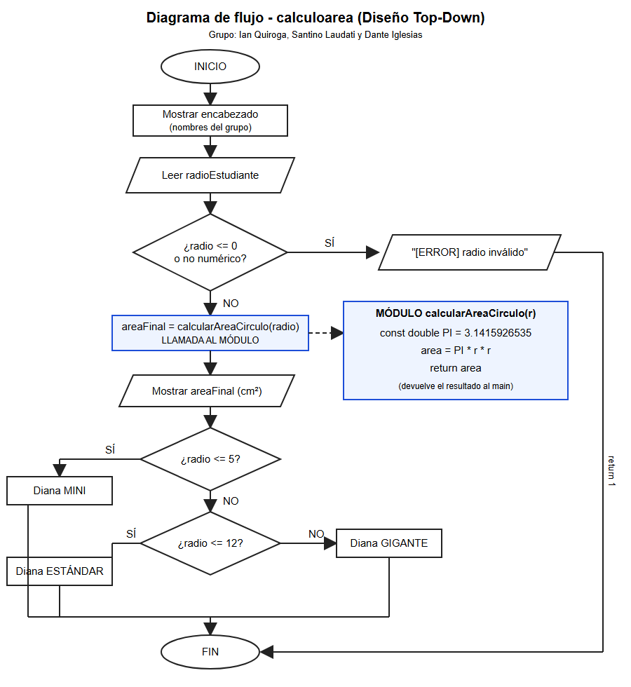
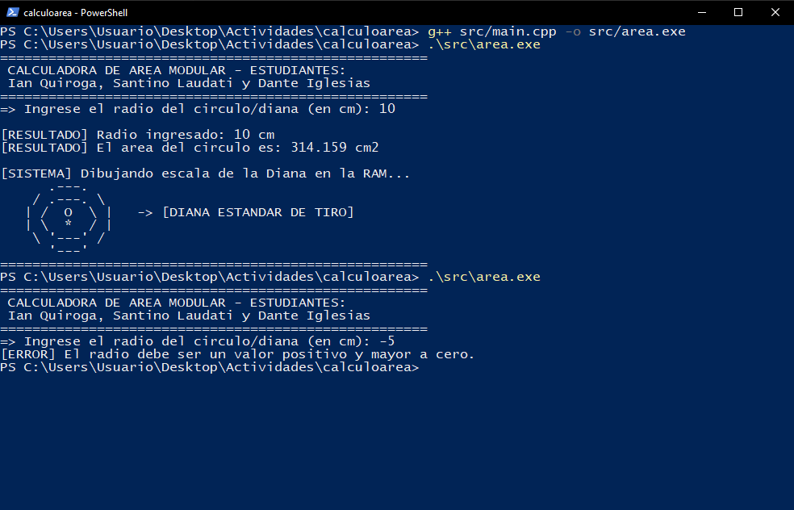

# 1. Propósito del documento

Este manual documenta la arquitectura modular del programa **calculoarea**, que calcula el área de un círculo (A = π · r²) y dibuja una diana ASCII según el radio. Explica los módulos, sus contratos (parámetros y retorno), cómo compilar y cómo extender el programa.

# 2. Requisitos

| Herramienta | Versión |
|---|---|
| g++ (MSYS2 UCRT64) | 16.1.0 o superior |
| Visual Studio Code | Con extensión C/C++ |
| Sistema operativo | Windows 10/11 |

# 3. Estructura del repositorio

```
calculoarea/
├── .gitignore  ├── LICENSE  ├── README.md
├── docs/InformeProyectoCALCULOAREA.pdf
├── docs/manuales/manual_programador_v1.0.0.(md|pdf)
├── src/main.cpp
└── capturas/compilacion_area.png, diagrama_flujo.png
```

# 4. Arquitectura Top-Down

| Nivel | Módulo | Responsabilidad |
|---|---|---|
| 0 | `main()` | Coordina entrada, validación, llamada y salida |
| 1 | Filtro de consistencia | Rechaza radios ≤ 0 o no numéricos (`return 1`) |
| 1 | `calcularAreaCirculo(r)` | Calcula y devuelve el área |
| 1 | Render de diana | Dibuja la diana según el rango del radio |



# 5. Referencia de funciones

## 5.1 `double calcularAreaCirculo(double r)`

| Elemento | Detalle |
|---|---|
| Prototipo | `double calcularAreaCirculo(double radio);` (antes de `main`) |
| Parámetro | `r` – radio en centímetros, debe ser > 0 |
| Variables locales | `const double PI = 3.1415926535;` y `double area` |
| Retorno | Área del círculo en cm² (`double`) |
| Precondición | El llamador ya validó que `r > 0` |

```cpp
double calcularAreaCirculo(double r) {
    const double PI = 3.1415926535;
    double area = PI * r * r;
    return area;
}
```

## 5.2 Rangos de la diana

| Radio | Dibujo |
|---|---|
| r ≤ 5 | Diana MINI / COMPACTA |
| 5 < r ≤ 12 | Diana ESTÁNDAR DE TIRO |
| r > 12 | Diana GIGANTE DE COBERTURA |

# 6. Compilación y ejecución

```powershell
g++ src/main.cpp -o src/area.exe
.\src\area.exe
```

Códigos de salida: `0` = cálculo correcto, `1` = radio inválido.



# 7. Pruebas

| Entrada | Salida esperada | Estado |
|---|---|---|
| 3 | 28.2743 cm² – diana mini | OK |
| 10 | 314.159 cm² – diana estándar | OK |
| 20 | 1256.64 cm² – diana gigante | OK |
| 0 / -5 / abc | Mensaje de error | OK |

# 8. Guía de mantenimiento

- Para agregar otra figura (por ejemplo `calcularAreaCuadrado`), declarar su prototipo arriba de `main()` y su desarrollo debajo, siguiendo el mismo patrón.
- No modificar `PI` fuera de la función: está protegido con `const`.
- Si se cambian los rangos de la diana, actualizar la tabla 5.2 y el diagrama de flujo.
